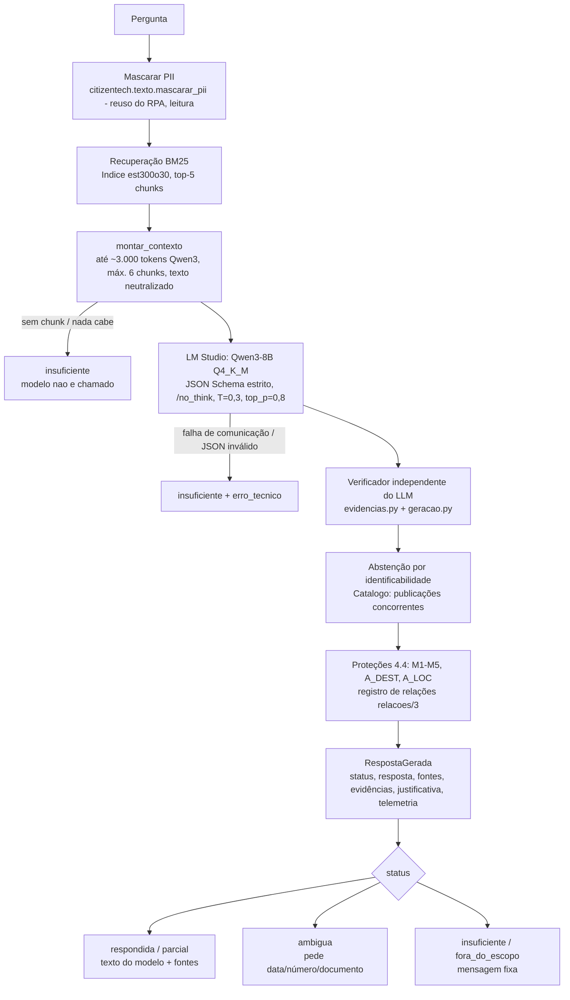

# Arquitetura do módulo Gen AI

Baseada na leitura do código atual (`citizentech/assistente/`) e dos relatórios de cada etapa. Candidata: `fail-closed-4.4.4d1-cand` (`geracao.VERSAO_POLITICA`). O que está descrito aqui como "componente" existe em código; protótipos e simulações **não** aparecem no diagrama principal (ver §8).

## 1. Fluxo de consulta (tempo de execução)

Observações: `priorizar_atributo` (seleção de contexto "S1 conservadora") é **desligada por padrão** e não faz parte do fluxo acima. O índice vetorial (e5) e o RRF existem no código do retriever, mas a consulta usa só **BM25** (`modo="bm25"`).

## 2. Ingestão e preparação (offline)
| Passo | Módulo | O que faz |
|---|---|---|
| Aquisição e integridade | `dados.py`, `data_assistente/dodf_original/MANIFESTO.json` | Lê os Parquet do corpus (1.381 documentos) e da validação (150 perguntas); confere SHA-256 contra o `oid` do Hugging Face. O conjunto de teste (350) não foi baixado |
| Deduplicação | `dedup.py` | 76 duplicatas exatas (mesma chave estrutural e texto) → 1.305 documentos canônicos; `ids_equivalentes` preservados |
| Associação QA→publicação | `associacao.py` | Reconstrói, para cada pergunta de validação, o(s) documento(s) correspondente(s) por igualdade exata do texto (150/150 resolvidas); usada só para avaliação, não na consulta |
| Catálogo | `catalogo.py` | Visão do corpus usada em tempo de consulta para decidir se a publicação citada é a única relevante (identificabilidade) e para localidades |

## 3. Chunking
`chunking.py`: estratégias `tamanho` e `estrutura` (unidades Art./§/incisos/itens → frases → palavras, overlap só com unidades inteiras). Unidade de tamanho: *token de superfície*. Configuração adotada: **`est300o30`** (estrutura, 300 tokens, overlap 30; 16.199 chunks canônicos). IDs: `dodf-<id>:est300o30:<ordem>`; cada chunk guarda metadados (edição, data, seção, referência, tipo, número…) e um cabeçalho contextual usado na indexação.

## 4. Indexação e recuperação
`texto_busca.py` (normalização), `bm25.py` (Okapi, `k1=1,5`, `b=0,75`, `scipy.sparse`), `codificador.py` (`multilingual-e5-small`, 384-d, CPU), `retriever.py` (`Indice.construir/salvar/carregar/buscar` com modos `bm25`, `vetorial`, `hibrido` por RRF `k=60`). Índices em `data_assistente/indices/{est300o30,est500o50}`. **Decisão:** o pipeline usa `modo="bm25"` em `est300o30`, congelado desde a Etapa 3 (BM25 superou o híbrido nos experimentos; ver `METODOLOGIA_E_EXPERIMENTOS.md`).

## 5. Geração
`geracao.py`: `ConfigGeracao` (URL local do LM Studio, modelo `qwen3-8b`, `max_chunks=5` (limite 6), `orcamento_tokens=3000`, `temperatura=0,3`, `top_p=0,8`, `max_tokens_saida=1100`, timeouts, `tentativas_json=2`); `ClienteLMStudio`; `montar_contexto` (itens `[C1]..[Cn]` dentro de `<DOCUMENTOS_NAO_CONFIAVEIS>`, neutralização de marcadores e de trechos que parecem instrução; chunk acima de 350 tokens é cortado e sinalizado; o que não cabe no orçamento é descartado e contado); prompt de sistema (versão v3) com regras de uso exclusivo das evidências, citação literal, abstenção e proibição de orientação médica; saída em JSON Schema (`candidatas`, `status`, `resposta`, `fontes`, `evidencias`, `justificativa`).

## 6. Validação de respostas e abstenção
A validação é **independente do modelo** (`validar_saida`, `evidencias.py`, `geracao._aplicar_politica`):
1. **Estrutura e rastreabilidade:** esquema/tipos; `fontes` e `candidatas` só com ids do contexto enviado; cada `evidencia.trecho` deve existir no chunk citado (comparação por tokens; estados literal/reparada/fabricada/não literal); `respondida` exige fonte, evidência literal e todo número da resposta nos chunks citados; vazamento do prompt; alfabeto estranho.
2. **Alinhamento e afirmações não sustentadas:** nomes, números, período e mês da pergunta devem constar da evidência citada ou da mesma publicação (origem registrada); afirmações da resposta sem apoio nos trechos citados.
3. **Conflito entre publicações:** o modelo lista `candidatas` antes de decidir; em pergunta de resposta única, candidatas literais divergentes de publicações diferentes forçam `ambigua`.
4. **Identificabilidade (4.2/4.3):** com o `Catalogo`, pergunta de resposta única cuja publicação não é a única relevante vira `ambigua`; lista com cobertura incompleta vira `parcial` com aviso explícito.
5. **Proteções 4.4** (flags em `PROTECOES_44`: `M1…M5`, `A_DEST`, `A_LOC`), todas só **rebaixam** para `insuficiente` ou reescrevem o texto de uma `parcial`: M1 ausência/remissão/cobertura; M2 conflito entre atributo pedido e rótulo do valor; M3 item de lista; M4 período; M5 localidade/entidade por associação estrutural; A_DEST destinatário do registro; A_LOC localidade da publicação. `_relacoes_44` registra, por trecho usado, o esquema auditável `relacoes/3` (entidade, atributo, rótulo, estado, causas, necessidade do trecho; mecanismo B = o conflito só bloqueia se o trecho for necessário para algum termo da resposta).
6. **Mensagem ao cidadão:** só `respondida` e `ambigua` usam texto do modelo; em `insuficiente`/`fora_do_escopo` a mensagem é fixa e o texto do modelo fica em `justificativa`.

## 7. Tratamento de abstenção (status)
`respondida` (resposta completa verificada), `parcial` (resposta incompleta/lista, com aviso), `ambigua` (várias publicações plausíveis; pede esclarecimento), `insuficiente` (evidência não sustenta), `fora_do_escopo`. A distinção entre `insuficiente` e `fora_do_escopo` **não é confiável** (rótulo impreciso; o comportamento de abster-se está correto). Falhas técnicas nunca levantam exceção ao chamador: viram `insuficiente` com `telemetria.erro_tecnico`.

## 8. Fora do fluxo (experimental ou de medição)
- **Medição:** `grupos.py` (reconstrói o contexto realmente enviado; grupos A/B), `metricas.py`, `avaliar_retriever.py`, `avaliar_chunking.py`, `avaliacao_geracao.py`, `avaliacao_e2e.py`, `auditoria*.py`.
- **Experimental (não integrado à candidata):** seleção de contexto S1 (flag `priorizar_atributo`, `False` por padrão); protótipos 4D.3–4D.7 (vínculo entidade–atributo por frase, políticas de veto V0–V3) em `docs/assistente/diagnostico_4_4/fase4/fase4d3..fase4d7/`, que **importam** funções puras de `evidencias.py` apenas para leitura e não modificam o código de produção.
- **Dependência do RPA:** `geracao.py` importa `citizentech.texto.mascarar_pii` (módulo RPA congelado, somente leitura).

## 9. Componentes e responsabilidades
| Arquivo | Responsabilidade |
|---|---|
| `dados.py`, `dedup.py`, `associacao.py` | corpus, integridade, duplicatas, associação QA→documento |
| `chunking.py`, `texto_busca.py` | segmentação e normalização |
| `bm25.py`, `codificador.py`, `retriever.py`, `construir_indice.py` | índices e recuperação |
| `catalogo.py` | identificabilidade da publicação e localidades |
| `geracao.py` | contexto, cliente LM Studio, prompt, política de status, proteções, `RespostaGerada` |
| `evidencias.py` | funções puras de verificação (citação, alinhamento, rótulos, períodos, destinatário, localidade, relações) |
| `grupos.py` | medição do contexto realmente enviado |
| `scripts/verificar_hashes.py` | integridade de artefatos e do RPA congelado (somente leitura) |
