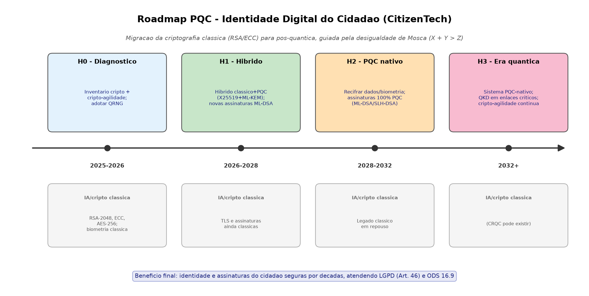

# Computação Quântica aplicada ao CitizenTech
## Identidade Digital do Cidadão + Criptografia Pós-Quântica (PQC)

**Integrantes:** Vinicius Araujo (RM564504), Gustavo Balbo (RM561711), Henry Gimenez (RM563217)
**Matéria:** Computação Quântica — Global Solution
**Foco:** raciocínio (não há implementação de algoritmo quântico)

---

## 1. A solução CitizenTech analisada

**Identidade Digital do Cidadão** — uma carteira digital de identidade (no espírito do
gov.br / carteira digital), que permite ao cidadão:

- guardar e apresentar documentos (RG, CPF, CNH, título, certidões);
- autenticar-se em serviços públicos e privados com **biometria facial/digital**;
- **assinar documentos digitalmente** (contratos, procurações, requerimentos) com validade
  jurídica (modelo ICP-Brasil);
- receber **credenciais verificáveis** (ex.: comprovante de vacina, matrícula, benefício).

**Persona:** qualquer cidadão que precise se identificar ou assinar à distância — do jovem
que abre conta bancária pelo celular ao idoso que assina uma procuração sem ir ao cartório.

**O que a IA clássica entrega hoje:**
- **Biometria** com visão computacional (reconhecimento facial + *liveness detection* para
  evitar fraude com foto/vídeo);
- **Detecção de fraude/anomalia** em tentativas de acesso (modelos clássicos de ML);
- **OCR e validação** automática de documentos.

**O que a criptografia clássica protege hoje:**
- **Assinaturas digitais** e autenticação com **RSA-2048** e **curvas elípticas (ECC)**;
- **Sigilo em trânsito** com TLS (troca de chaves por RSA/ECDH);
- **Sigilo em repouso** com AES-256 (dados e *templates* biométricos).

É exatamente essa camada criptográfica — não a IA em si — que concentra o gargalo quando o
sistema cresce para dezenas de milhões de cidadãos.

---

## 2. Ponto 1 — O gargalo real (e por que piora com a escala)

O enunciado define gargalo como o ponto em que a solução fica **lenta, cara, imprecisa ou
insegura** conforme o número de cidadãos cresce. Aqui o eixo crítico é **INSEGURANÇA
criptográfica em escala**:

> **A identidade e as assinaturas do cidadão são protegidas por RSA/ECC, que um computador
> quântico criptograficamente relevante (CRQC) quebrará com o algoritmo de Shor. Como os
> dados de identidade são vitalícios e as assinaturas precisam valer por décadas, o sistema
> vira um alvo gigante do ataque "colher agora, decifrar depois".**

### Por que é um gargalo que piora com a escala
1. **Honeypot crescente.** Cada novo cidadão adiciona dados sensíveis e de longuíssima
   duração. Milhões de registros = alvo de altíssimo valor para o ataque *Harvest Now,
   Decrypt Later* (HNDL): o adversário **captura hoje** o tráfego/armazenamento cifrado e
   **decifra no futuro**, quando houver um CRQC.
2. **Biometria é irrevogável.** Você troca uma senha, mas não troca o seu rosto ou a sua
   digital. Um vazamento decifrado no futuro é **catastrófico e permanente**.
3. **Assinaturas perdem validade retroativa.** Com Shor, assinaturas RSA/ECC poderiam ser
   **forjadas retroativamente**, derrubando a validade jurídica de milhões de contratos,
   procurações e escrituras já assinados.
4. **Não é um problema de velocidade — é uma quebra estrutural.** Aumentar o tamanho da
   chave RSA **não resolve** contra Shor (o ganho de Shor é exponencial). Ou seja, a
   solução clássica não fica apenas "mais cara": ela fica **fundamentalmente insegura**.

### Por que agir já: a desigualdade de Mosca
Michele Mosca formaliza a urgência com **X + Y > Z**:

- **X** = por quanto tempo os dados precisam permanecer secretos (aqui, **décadas** —
  identidade e biometria são vitalícias);
- **Y** = quanto tempo leva para migrar a criptografia de todo o sistema (anos, em escala
  nacional);
- **Z** = tempo até existir um CRQC (estimativas sérias apontam para a **década de 2030**).

Se **X + Y > Z**, já se está atrasado. Para identidade digital, X é enorme → **a migração
precisa começar agora**, mesmo que o CRQC ainda não exista.

---

## 3. Ponto 2 — A capacidade escolhida: Criptografia Pós-Quântica (PQC)

### A ameaça quântica (o lado quântico do problema)
- **Algoritmo de Shor** (em CRQC): quebra **RSA e ECC** (fatoração e logaritmo discreto) →
  derruba assinaturas e troca de chaves atuais.
- **Algoritmo de Grover**: dá *speedup* quadrático na busca por chaves simétricas → mitigado
  **dobrando** o tamanho da chave (AES-256 permanece seguro). Logo, o problema real é a
  **criptografia assimétrica**, não a simétrica.

### A resposta: PQC (e complementos genuinamente quânticos)
**PQC = Criptografia Pós-Quântica**: algoritmos que **rodam em computadores clássicos** mas
resistem a ataques quânticos, baseados em problemas matemáticos difíceis até para o quântico
(reticulados, hashes, códigos). Em **agosto de 2024** o NIST finalizou os primeiros padrões:

| Padrão NIST | Algoritmo (origem) | Uso |
|---|---|---|
| **FIPS 203** | ML-KEM (Kyber) — reticulados | Troca/encapsulamento de chaves |
| **FIPS 204** | ML-DSA (Dilithium) — reticulados | Assinatura digital |
| **FIPS 205** | SLH-DSA (SPHINCS+) — hashes | Assinatura digital (conservadora) |

**Complementos realmente quânticos** (opcionais no roadmap):
- **QRNG** (gerador quântico de números aleatórios): chaves com aleatoriedade de qualidade
  física — **disponível hoje** e de baixo custo.
- **QKD** (distribuição quântica de chaves): sigilo garantido por física, mas **cara, de
  alcance limitado e para enlaces críticos** — nicho de longo prazo.

### Por que PQC e não as outras capacidades quânticas
| Capacidade | Atacaria o gargalo? | Avaliação |
|---|---|---|
| **PQC** | **Sim** | Ataca diretamente a quebra de RSA/ECC — o gargalo de segurança. **Escolhida.** |
| Busca (Grover) | Parcial | Útil para busca em base, mas não é o gargalo de identidade; e ameaça simétrica é mitigável com AES-256. |
| Otimização (QAOA) | Não | Boa para agendamento/filas; irrelevante para o sigilo da identidade. |
| Simulação | Não | Voltada a química/materiais; sem relação com o problema. |

PQC é a **única** que ataca o gargalo definido (segurança/LGPD de dados sensíveis vitalícios
em escala).

---

## 4. Ponto 3 — Roadmap realista

Mostra o que a **IA/criptografia clássica entrega hoje**, o que o **quântico/PQC agrega** e o
**benefício para o cidadão**.

| Horizonte | Período | IA/cripto clássica hoje | O que PQC/quântico agrega | Benefício para o público |
|---|---|---|---|---|
| **H0 — Diagnóstico** | 2025–2026 | RSA-2048, ECC, AES-256; biometria clássica | **Inventário criptográfico** + **cripto-agilidade** (poder trocar algoritmo sem refazer o sistema); adotar **QRNG** na geração de chaves | Base pronta para migrar sem travar o serviço |
| **H1 — Híbrido** | 2026–2028 | TLS e assinaturas ainda clássicas | **Criptografia híbrida** (clássico **+** PQC, ex.: X25519 **+** ML-KEM) em trânsito e nas **novas** assinaturas (ML-DSA) | Dados e assinaturas **novos** já protegidos contra HNDL, mantendo compatibilidade |
| **H2 — PQC nativo** | 2028–2032 | Legado clássico em repouso | **Recifrar** dados/biometria em repouso com PQC; assinaturas 100% **ML-DSA/SLH-DSA**; carimbo do tempo PQC | Validade jurídica das assinaturas preservada; honeypot protegido contra CRQC |
| **H3 — Era quântica** | 2032+ | — | Sistema **PQC-nativo**; **QKD** em enlaces governamentais críticos; cripto-agilidade contínua para novos padrões | Identidade do cidadão **segura ao longo de toda a era quântica** |

**Realismo do cronograma:** a migração começa **antes** do CRQC existir porque (i) a
desigualdade de Mosca exige, (ii) os padrões NIST já existem (desde 2024) e (iii) migração
nacional leva anos. Não se "programa um computador quântico": adota-se PQC em software/HSMs
clássicos e usa-se QRNG hoje; QKD fica para quando custo/alcance justificarem.

---

## 5. Ponto 4 — Ética, LGPD e ODS ao longo do roadmap

### LGPD (Lei nº 13.709/2018)
- **Biometria é dado pessoal sensível** (Art. 5º, II) → exige proteção reforçada.
- **Princípio da segurança** (Art. 6º, VII) e **medidas técnicas adequadas** (Art. 46): a
  LGPD cobra proteção "considerando o estado da arte". Com padrões PQC já publicados, migrar
  passa a fazer parte da **devida diligência** — ignorar a ameaça HNDL tende a configurar
  negligência.
- **Minimização** (Art. 6º, III): guardar o mínimo reduz o tamanho do honeypot e o dano de
  um futuro vazamento.
- **Prestação de contas** (Art. 6º, X): documentar o inventário criptográfico e o plano de
  migração é evidência de conformidade.

### Ética
- **Irrevogabilidade da biometria:** como o rosto não se "re-emite", o dever ético de
  proteção é maior — justifica agir cedo (H0/H1), não esperar o CRQC.
- **Equidade e divisão digital:** chaves e assinaturas PQC são **maiores**; é preciso que
  celulares antigos e conexões ruins continuem funcionando, para **não excluir** o cidadão
  mais vulnerável — justamente o que o CitizenTech quer incluir.
- **Transparência e soberania:** explicar ao cidadão como seus dados são protegidos; evitar
  dependência de um único fornecedor (cripto-agilidade) e fortalecer capacidade nacional.
- **Não assustar nem adiar:** comunicar a ameaça quântica sem alarmismo, mas sem postergar.

### ODS (Agenda 2030)
- **ODS 16 — Instituições fortes:** a meta **16.9** ("identidade legal para todos até 2030")
  é atendida diretamente pela identidade digital; o PQC **protege esse direito a longo prazo**.
- **ODS 9 — Indústria, inovação e infraestrutura:** infraestrutura digital resiliente à era
  quântica.
- **ODS 10 — Redução das desigualdades:** inclusão digital só se concretiza se a migração
  PQC **não deixar ninguém para trás** (dispositivos simples).
- **ODS 8 — Trabalho e crescimento:** confiança em assinaturas digitais sustenta a economia
  digital.

### Mapa ética/LGPD/ODS por horizonte
| Horizonte | LGPD | Ética | ODS |
|---|---|---|---|
| H0 | Inventário = prestação de contas | Preparar-se cedo (dever reforçado) | 16 (base de confiança) |
| H1 | Novos dados já protegidos (Art. 46) | Equidade: híbrido mantém compatibilidade | 9, 16 |
| H2 | Legado recifrado; validade jurídica | Proteger o irrevogável (biometria) | 16.9, 10 |
| H3 | Segurança "estado da arte" contínua | Soberania e não exclusão | 9, 10, 16 |

---

## 6. Conclusão — quando faz sentido, de forma realista

O gargalo do CitizenTech "Identidade Digital" **não é desempenho da IA**, é a **segurança
criptográfica de dados vitalícios em escala** diante da ameaça quântica. A capacidade certa é
a **PQC**, porque ataca exatamente a quebra de RSA/ECC por Shor, enquanto otimização, busca e
simulação não tocam esse problema.

O **quando** é claro pela desigualdade de Mosca: como a identidade precisa ficar secreta por
décadas, a migração deve **começar agora** (inventário, cripto-agilidade, QRNG e híbrido com
os padrões NIST de 2024), avançar para **PQC nativo** até o início dos anos 2030 e manter
cripto-agilidade na era do CRQC. Tudo isso **sem programar um algoritmo quântico**: o esforço
é de arquitetura, governança e migração — com ética, LGPD e ODS guiando cada etapa.

---

## Referências
- NIST, *Post-Quantum Cryptography Standards* — **FIPS 203 (ML-KEM), 204 (ML-DSA), 205
  (SLH-DSA)**, agosto/2024.
- P. Shor, *Algorithms for quantum computation: discrete logarithms and factoring* (1994).
- L. Grover, *A fast quantum mechanical algorithm for database search* (1996).
- M. Mosca, *Cybersecurity in an era with quantum computers* — desigualdade **X + Y > Z**.
- Brasil, **LGPD** — Lei nº 13.709/2018 (Art. 5º II; Art. 6º III, VII, X; Art. 46).
- ONU, **Objetivos de Desenvolvimento Sustentável** — meta **16.9** (identidade legal para
  todos).
- Conceito **Harvest Now, Decrypt Later (HNDL)** — motivação central da migração antecipada.
