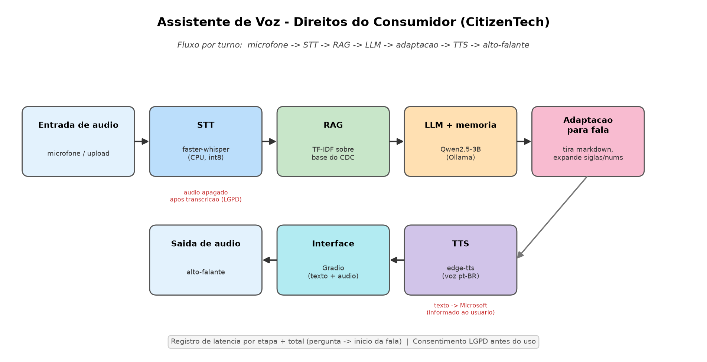

# Relatório — Assistente de Voz CitizenTech: Direitos do Consumidor

> Rascunho para exportar em PDF. Preencha os campos entre colchetes e as tabelas de
> resultados após rodar os testes.
>
> **Integrantes:** Vinicius Araujo (RM564504), Gustavo Balbo (RM561711), Henry Gimenez (RM563217).

## 1. Problema e persona
Milhões de brasileiros têm dificuldade com interfaces de texto — pessoas idosas, com
baixa alfabetização, com deficiência visual ou motora. Ao mesmo tempo, dúvidas sobre
**direitos do consumidor** (cobrança indevida, produto com defeito, garantia) são
comuns e a orientação confiável é de difícil acesso para esse público.

- **Persona:** Dona Maria, 67 anos, aposentada, pouca familiaridade com celular e com
  dificuldade de leitura em telas. Foi cobrada duas vezes na mesma fatura e não sabe a
  quem recorrer nem quais são seus direitos. Prefere falar a digitar.
- **Problema resolvido:** dar orientação falada, simples e confiável sobre o Código de
  Defesa do Consumidor, sem exigir leitura ou digitação, aproximando o cidadão de canais
  oficiais (Procon, consumidor.gov.br, Defensoria).

## 2. ODS relacionado
- **ODS 16** — Paz, Justiça e Instituições Eficazes: amplia o acesso à informação e à
  justiça (Procon, Defensoria, Juizado).
- **ODS 12** — Consumo e Produção Responsáveis: consumidores mais informados sobre seus
  direitos.

## 3. Arquitetura
Fluxo: **microfone/upload → STT → RAG → LLM (com memória) → adaptação para fala → TTS →
alto-falante**, com texto exibido na tela. Cada etapa é um módulo separado (ver README).

## 4. Justificativa das escolhas

### Local vs nuvem
Optamos por **execução local**: privacidade (áudio não sai da máquina), custo zero e
funcionamento offline de STT e LLM. Única exceção: o `edge-tts` envia o **texto** da
resposta à Microsoft (informado ao usuário). Trade-off: maior latência em CPU, mitigada
com quantização `int8` e modelos de 3B.

### Base de conhecimento (RAG)
Usamos **RAG por TF-IDF** sobre uma base curada do CDC em vez de embeddings pesados:
roda em CPU, latência baixa, e dá ao LLM trechos citáveis (artigos do CDC), reduzindo
alucinação. Quando nenhum trecho é relevante, o assistente diz que não sabe.

### Modelos comparados
| Comparação | Opção A | Opção B | Métrica | Escolha final |
|---|---|---|---|---|
| **STT** | Whisper `base` (WER 33,4% / 0,98 s) | Whisper `small` (WER 18,9% / 2,70 s) | WER × latência | **`small`** — quase metade do erro por ~2,7 s, aceitável em CPU |
| LLM (opcional) | Qwen2.5-3B | Llama3.2-3B | acerto × latência | Qwen2.5-3B (não comparamos Llama; comparação obrigatória feita no STT) |

## 5. Resultados das métricas

### 5.1 STT — WER (jiwer)
20 áudios, ≥3 vozes, ≥5 com ruído. (`tests/avaliar_stt.py` → `logs/wer.csv`.)

| Modelo | WER médio | Latência média (s) |
|---|---|---|
| Whisper base | 33,4% | 0,98 |
| Whisper small | **18,9%** | 2,70 |

> Observação: as transcrições de referência usadas foram as frases do roteiro. Em alguns
> áudios o locutor desviou um pouco do roteiro, o que eleva o WER (não é só erro do STT).
> Para um WER ainda mais justo, ajustar `tests/transcricoes_ref.json` para o que foi
> exatamente falado. A comparação base × small permanece válida (mesma referência p/ os dois).

### 5.2 LLM — acertos e recusas
30 perguntas (20 normais, 5 continuação, 5 fora do escopo). (`tests/avaliar_llm.py`.)

| Métrica | Resultado |
|---|---|
| Respostas corretas (conteúdo) | 22/25 = 88% (varia 88–92% por execução, temperatura 0,3) |
| Recusas adequadas (fora do escopo) | 5/5 = 100% |

> A recusa é robusta: o assistente recusa saúde, política, código, clima, etc., iniciando
> sempre com "Desculpe, só posso ajudar com dúvidas sobre direitos do consumidor." As
> perguntas de continuação (memória) foram respondidas corretamente (ex.: "e onde eu faço
> isso?" lembrou que era compra pela internet).

### 5.3 TTS — avaliação humana (1 a 5)
10 áudios avaliados por ≥3 pessoas. (`tests/avaliar_tts.py` → `logs/avaliacao_tts.csv`.)

| Critério | Nota média (3 avaliadores) |
|---|---|
| Naturalidade | 5,0 |
| Clareza | 5,0 |

> A voz sintética pt-BR (edge-tts, `pt-BR-AntonioNeural`) foi avaliada como natural e
> clara pelos 3 avaliadores, com o texto já adaptado para fala (sem markdown, siglas e
> números por extenso).

### 5.4 Ponta a ponta — latência
10 conversas × 3 turnos. (`tests/ponta_a_ponta.py` → `logs/latencia_e2e.csv`.)

| Etapa | Latência média (s) |
|---|---|
| STT | 2,62 |
| RAG | ~0,00 (TF-IDF, instantâneo) |
| LLM | 3,75 |
| Adaptação | ~0,00 |
| TTS | 4,30 |
| **Total (pergunta → início da fala)** | **10,67** (máx 14,90) |

> Medido em CPU (sem GPU), com STT `small` e Qwen2.5-3B. As etapas RAG e adaptação são
> praticamente instantâneas. O maior custo é TTS (nuvem) e LLM. Com GPU a latência cairia bastante.

## 6. Cuidados com LGPD e ética
- **Consentimento** exibido antes do uso; aceite registrado.
- **Retenção mínima:** áudio apagado após a transcrição; não há banco de áudios.
- **Nuvem:** apenas o texto da resposta vai ao edge-tts (informado).
- **Limites:** recusa de temas fora do escopo; encaminhamento a Procon/Defensoria/advogado.
- **Anti-alucinação:** diz que não sabe quando falta base.
- **Clonagem de voz:** proibida; apenas vozes sintéticas prontas.

### Análise de viés do STT
WER médio por voz (modelo `small`), a partir de `logs/wer.csv`:

| Voz | WER médio (small) | Nº de áudios |
|---|---|---|
| Voz 1 | 23,9% | 7 |
| Voz 2 | 13,7% | 7 |
| Voz 3 | 19,3% | 6 |

Há diferença entre as vozes: a Voz 1 teve o maior WER e a Voz 2 o menor. Parte dessa
diferença vem de desvios do roteiro na gravação (ver observação em 5.1) e não só de viés
do modelo. Para a acessibilidade, isso mostra a importância de testar com vozes variadas:
se o STT erra mais com um perfil de fala, esse cidadão é pior atendido.

**Com x sem ruído** (modelo `small`): os 5 áudios com ruído de fundo são
`voz3_audio2` a `voz3_audio6`.

| Condição | WER médio (small) | Nº de áudios |
|---|---|---|
| Com ruído | 23,1% | 5 |
| Sem ruído | 17,5% | 15 |

O ruído de fundo elevou o WER em ~5,6 pontos percentuais, como esperado: ambientes
barulhentos (rua, TV) prejudicam a transcrição. Para o cidadão, isso reforça a
importância do filtro de voz (VAD, já ativado no STT) e de orientar o uso em local mais
silencioso quando possível.

## 7. Limitações e melhorias futuras
- Latência em CPU; uma GPU (Colab T4) reduziria bastante o tempo de STT e LLM.
- Base de conhecimento pequena; ampliar com mais temas e fontes oficiais atualizadas.
- TTS depende de internet (edge-tts); alternativa 100% offline: Piper.
- RAG por TF-IDF é simples; embeddings melhorariam a recuperação em bases maiores.
- Adicionar detecção automática de voz (VAD) para dispensar o botão "apertar para falar".
